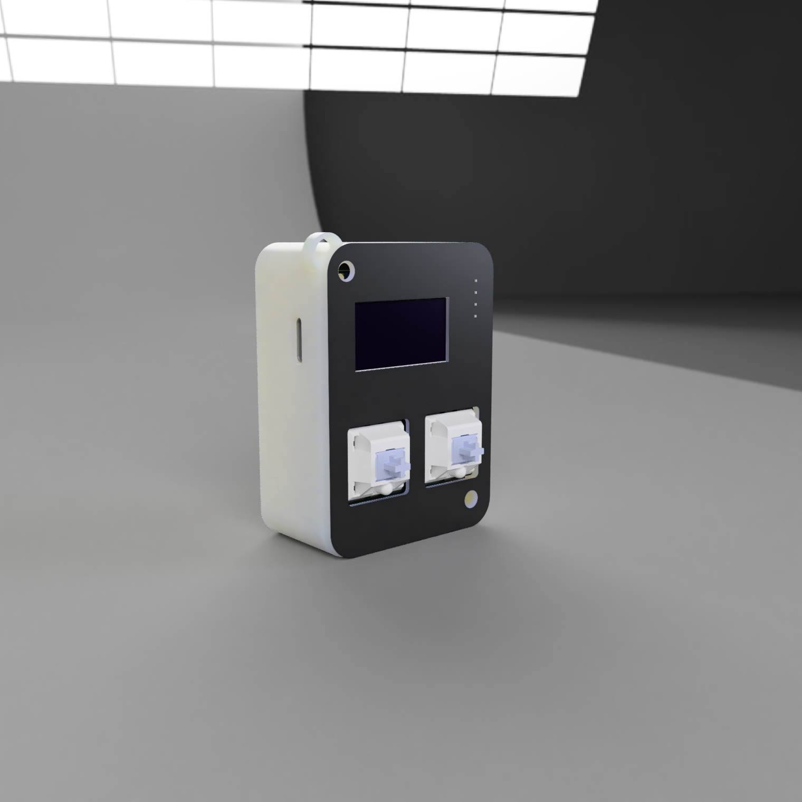

# Starbie

### A Esp32_C3 based digital pet that u can play with and keep it alive if u dont it dies (x_x) ,sad thats why u have to keep it alive 

  
  

## Renders
- **Schematic**

- **Pcb layout**

- **Pcb**

Full parts list with quantities and costs: **[BOM.csv](BOM.csv)**

