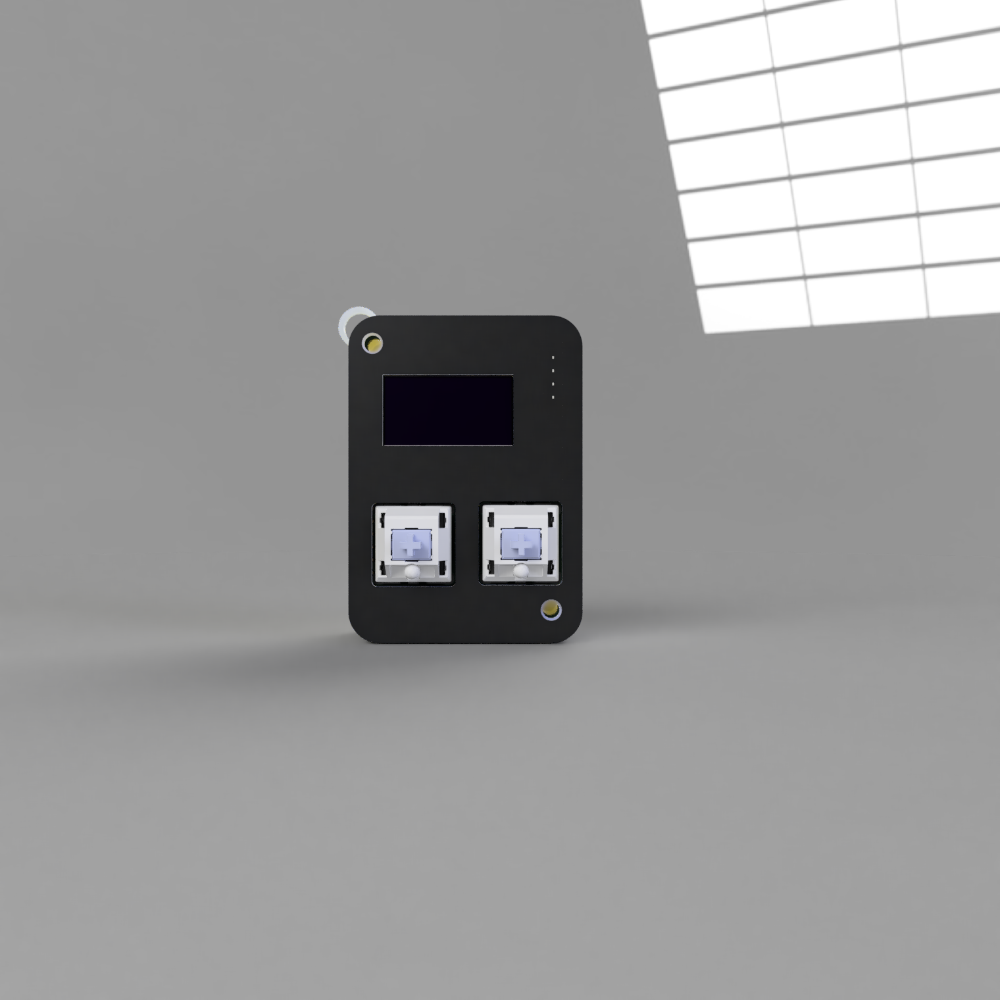

# Project Title

  
  

 A Esp32_C3 based digital pet that u can play with and keep it alive if u dont it dies (x_x) ,sad thats why u have to keep it alive 

## Description
Starbie is a device made for digital pet I heavily referenced Tamagotchi and similar device I used a Esp32c3 microcontroller as the brain of the device and added DHT11 so it could sense the temprature around it and I added MPU6050 so it could feel movements and react to it 

### Screenshots

- **Schematic**

- **Pcb layout**

- **Pcb**

_ **Case**

## Getting Started
Full parts list with quantities and costs: **[BOM.csv](BOM.csv)**
first Download PCB files and edit them according your use and then order pcb
then solder all the components on the pcb board
and then flash it with the firmware add changes to it according to your need
3d print the case for it or don't use one. Its on u!

### Dependencies

#Libraries.

Open Sketch → Include Library → Manage Libraries. Install these libraries one at a time:

- **Adafruit GFX Library**
 
- **Adafruit SSD1306**

- **Adafruit MPU6050**

- **DHT sensor library**

If Arduino asks to install dependencies, choose Install All.

### Installing
- **Install the current **[Arduino IDE](https://www.arduino.cc/en/software)**.**

- **Open File → Preferences. In Additional Boards Manager URLs, add:

https://espressif.github.io/arduino-esp32/package_esp32_index.json**

- **Open Tools → Board → Boards Manager, search for esp32, and install esp32 by Espressif Systems.**

- **Under Tools → Board → esp32, select XIAO_ESP32C3.**

### Executing program

After installing ESp32 board and all the libraries open the **[Firmware.ino](Firmware/Starbie_firmware.ino)** file
When you get your board, click Arduino's arrow-shaped Upload button.

## License

This project is licensed under the MIT License - see the **[LICENSE](LICENSE)** file for details

----

