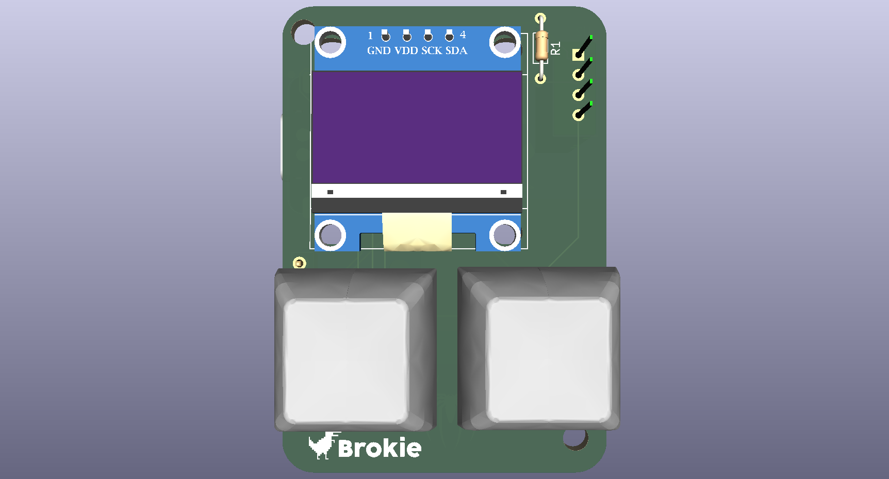
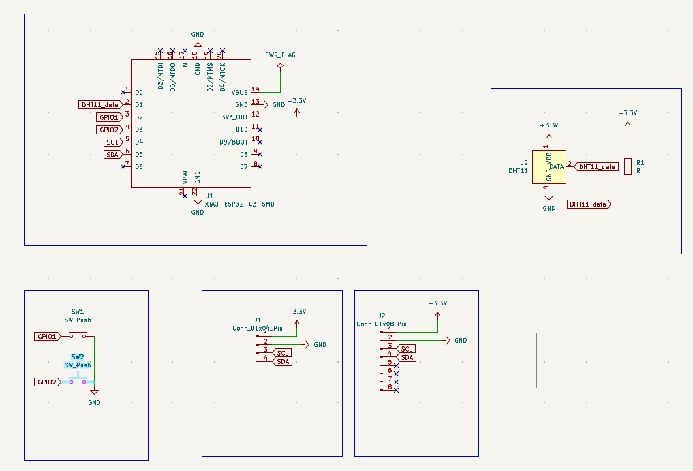
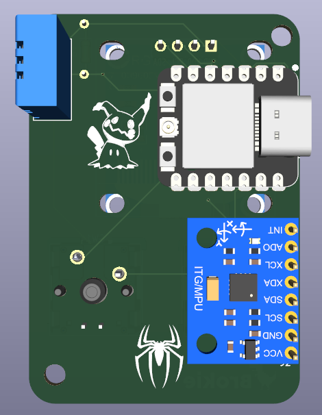
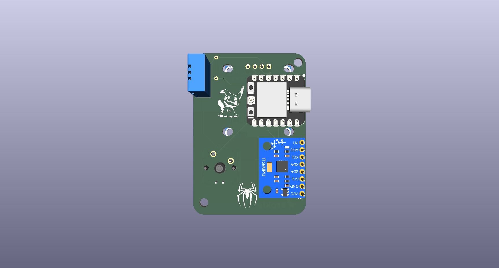

# Starbie

### A Esp32_C3 based digtal that u can play with and keep it alive if u dont it dies(x_x) sad thats why u have to keep it alive 

## Why 

This project was created to be the week 1 project for [halflife](https://halflife.hackclub.com/)!

## Renders
- **Schematic**

- **Pcb layout**

- **Pcb**

